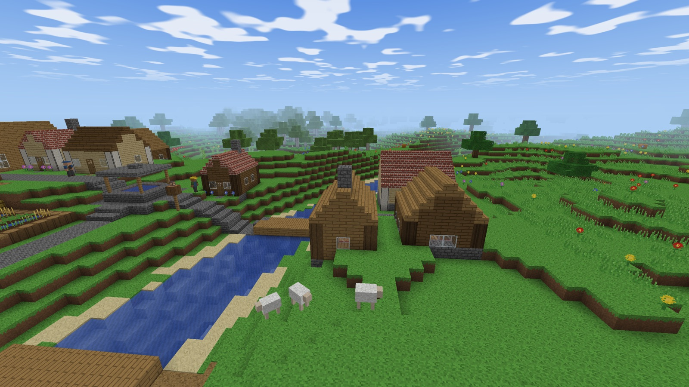
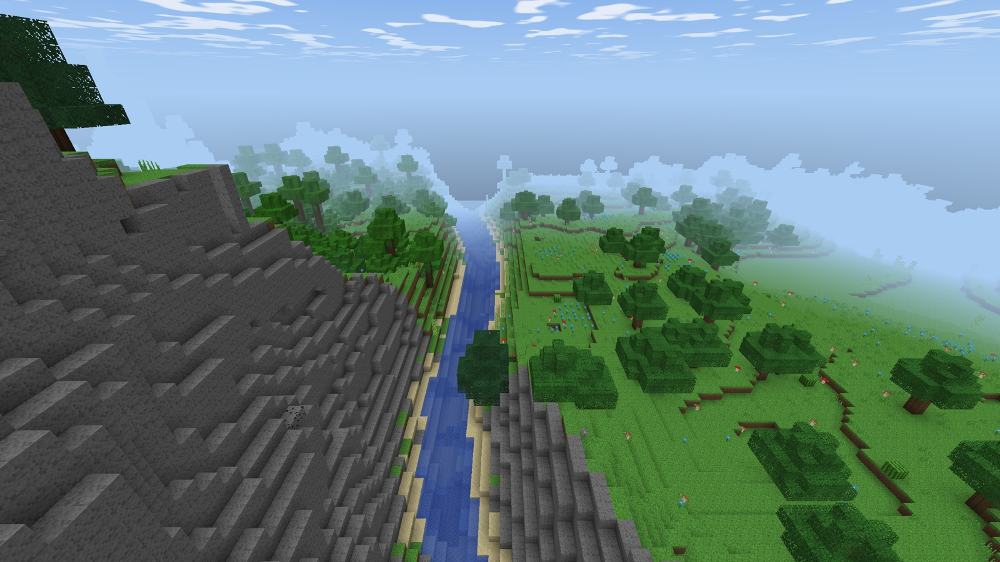
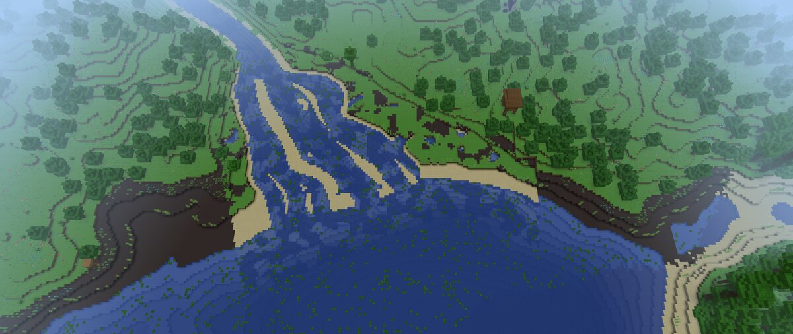
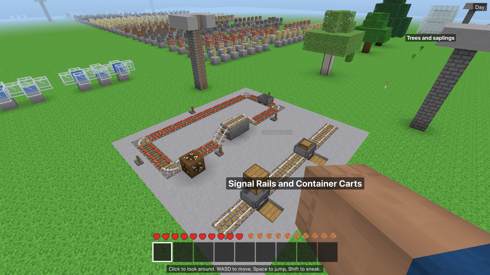
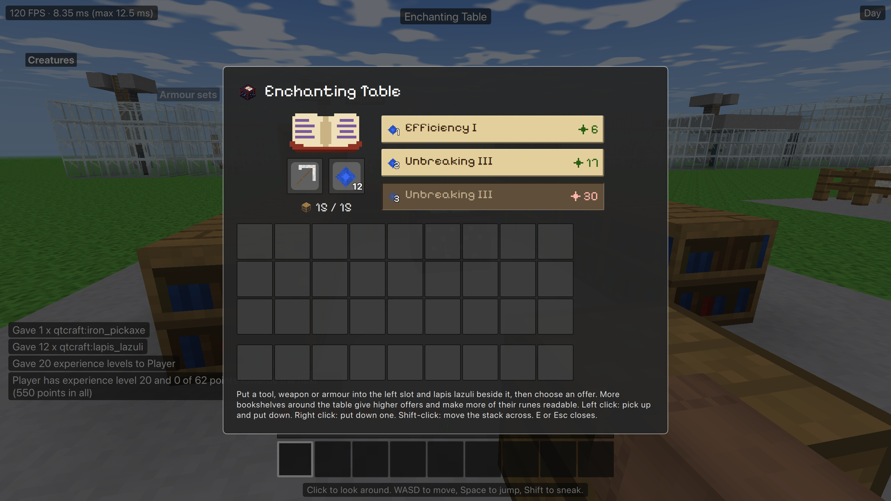

# QtCraft

A voxel sandbox game in the spirit of Minecraft, written from scratch in C++23 with Qt 6.8. Explore generated worlds with rivers, mountains and villages, mine and build, craft, farm and trade, wire up machines with Signal Dust, ride minecarts and survive the night – alone or with friends over an encrypted connection. Every texture, sound and piece of music is generated by the game itself, the content is plain JSON that mods can extend, and an in-game handbook documents every block, item and creature.



| | |
|---|---|
|  |  |
|  |  |

## Features

- **World:** procedurally generated terrain with 18 biomes, caves, ores, rivers and river deltas, lava lakes; day and night with sun and moon, weather, fire, flowing water and lava, falling sand and gravel. Also flat, void and a showcase world that shows everything the game contains.
- **Survival:** mining, crafting, furnaces, hunger and food, farming and animal breeding, armour, bows, explosives, experience, enchanting and anvils, maps, a backpack. Game modes survival, creative, adventure and spectator; game rules and server commands.
- **Building and Signal Dust:** stairs, slabs, doors, fences, signs, frames and paintings; Signal Dust circuits (the game's own name for redstone-like wiring) with levers, buttons, repeaters, comparators, observers, pistons, dispensers and hoppers; rails and minecarts.
- **Creatures and villages:** more than 25 kinds of creatures, from animals and pets to monsters by night; villages with houses, roads and bridges, villagers with professions and trading; temples, mineshafts and dungeons.
- **Multiplayer:** dedicated server or a world opened for the LAN, over TCP with TLS (the client pins the server's certificate on first contact), player list, chat, operators, whitelist, backups and a server administration screen. Single player runs through the same protocol with a local server.
- **Modding and texture packs:** data-only mods (blocks, items, recipes, creatures, structures, sounds) and texture packs, including HD packs; the handbook includes mods.
- **Tooling:** `qtcraft-headless` runs the dedicated server, bots and a JSON control interface for agents and tests; an offscreen screenshot mode, benchmarks and profiling scripts.
- **Polish:** gamepad support, freely bindable keys, first- and third-person views, a character editor, English and German.

## Platforms and downloads

- **macOS** 13.3 or later (Apple silicon and Intel): a universal, standalone `QtCraft.app` (zip and dmg) built by `scripts/release.sh`. It is signed ad hoc only, so the first start needs one confirmation (see [docs/Playing.md](docs/Playing.md#starting-the-game)).
- **Windows 10/11 x64:** a standalone zip (unpack, start `qtcraft.exe`), built in a Windows VM and played in playtests; the tests do not run under MSVC yet, and the Windows CI job is experimental and has not run yet.
- **Linux:** set up as an experimental CI job (not run yet); never played or packaged.

There are no published release downloads yet. The release workflow builds the macOS packages from a version tag into a draft release; until then, build from source.

## Quick start

1. Start the game (or build it, below).
2. **Create a new world**, pick a world type and game mode, and play. Press **H** for the handbook, **E** for the inventory, **Esc** for the menu.
3. The controls, settings and data folders are in [docs/Playing.md](docs/Playing.md); multiplayer in [docs/Multiplayer.md](docs/Multiplayer.md).

**A note on multiplayer and IPv6:** a dedicated server listens on all network interfaces, IPv4 and IPv6, by default (a world opened for the LAN only when “Also over IPv6” is on). With IPv6 there is no NAT, so unless a firewall blocks it, such a server can be reached from the internet at its IPv6 address. Set a password, and read [Limits of this security](docs/Multiplayer.md#limits-of-this-security-read-before-opening-a-server-to-the-internet) before opening a server.

## Build from source

Requirements: CMake 3.25+, Ninja, a C++23 compiler (Apple Clang or MSVC 2022), Qt 6.8 with Quick, QuickControls2, Multimedia, ShaderTools, LinguistTools and Test, Python 3, and `curl` and `perl` for the bundled OpenSSL. SDL3 (gamepads) and OpenSSL (TLS) are built once by the first configure step.

```sh
cp CMakeUserPresets.example.json CMakeUserPresets.json   # then set your Qt and Ninja paths
cmake --preset release
cmake --build --preset release
```

Presets, Windows, the macOS release bundle, tests, benchmarks and CI: [docs/Building.md](docs/Building.md).

## Documentation

Documents marked (de) are in German.

- [docs/Playing.md](docs/Playing.md) – starting the game, controls, settings, data folders
- [Handbook](docs/handbook/index.md) ([de](docs/handbook/de/index.md)) – every block, item, recipe, creature and biome, plus chapters on playing; generated from the content, also in the game and as a [web page](web/handbook/index.html) in the look of the game (published by the Pages workflow; locally open it through a web server, e.g. `python3 -m http.server -d web`)
- [docs/Multiplayer.md](docs/Multiplayer.md) – servers, hosting, TLS, ports, administration
- [docs/Modding.md](docs/Modding.md) – the mod format; [docs/Mod-Sicherheit.md](docs/Mod-Sicherheit.md) (de) – mod security
- [docs/Texturpakete.md](docs/Texturpakete.md) – texture packs
- [docs/Steuerschnittstelle.md](docs/Steuerschnittstelle.md) – the JSON control interface of `qtcraft-headless`
- [docs/Building.md](docs/Building.md) – building, packaging, tests, profiling, CI
- [docs/HowItWorks.md](docs/HowItWorks.md) – how the game works inside, a gentle tour with pointers into the code
- [docs/Architektur.md](docs/Architektur.md) – modules, threads, protocol, persistence, rendering, all command-line options
- [docs/Playtest.md](docs/Playtest.md) (de) – running a playtest: server on a Mac, Windows players, diagnostics
- [docs/Performance.md](docs/Performance.md), [docs/Performance-Verlauf.md](docs/Performance-Verlauf.md) (de) – frame cost, goals and measurements
- [docs/Entscheidungen.md](docs/Entscheidungen.md), [docs/FORTSCHRITT.md](docs/FORTSCHRITT.md), [docs/Log.md](docs/Log.md), [docs/archiv/Abschlussbericht.md](docs/archiv/Abschlussbericht.md) (de) – design decisions, progress, dated log and the historical report of stage 8
- [docs/ASSETS.md](docs/ASSETS.md), [CREDITS.md](CREDITS.md), [THIRD_PARTY.md](THIRD_PARTY.md) – assets, credits, third-party code

## About this project

I always wanted to build a Minecraft-like game, precisely because it lies outside my comfort zone and I wanted to learn how 3D rendering and all the rest of it work. AI made it possible: QtCraft is developed largely by AI coding agents, under my direction and review. I have to admit, though, that I didn't learn all that much about those things myself along the way :D

## Contributing

See [CONTRIBUTING.md](CONTRIBUTING.md) for building, testing, the branch and review workflow and the code rules; the complete working rules (German) are in [CLAUDE.md](CLAUDE.md). Every change goes through a feature branch; `scripts/verify.sh --quick --changed` checks a change while working, and the full `scripts/verify.sh` (all tests under ASan/UBSan and TSan, release build, static analysis, smoke screenshots) runs before a merge.

## Licence

QtCraft – code, textures, sounds and music – is licensed under the GNU General Public License version 3 or later (GPL-3.0-or-later), see [LICENSE](LICENSE) and [CREDITS.md](CREDITS.md). The release packages contain Qt, used under the GNU LGPL version 3, SDL3 for gamepads (zlib licence, statically linked) and OpenSSL 3 for TLS in multiplayer (Apache License 2.0, shared libraries). The logo uses the pixel font Pixelify Sans (SIL Open Font License 1.1). See [THIRD_PARTY.md](THIRD_PARTY.md).

QtCraft contains no Minecraft code or assets and is not affiliated with Mojang or Microsoft; comparisons with Minecraft are descriptive only. The wiring material is called Signal Dust. Qt is a registered trademark of The Qt Company Ltd. and its subsidiaries.
