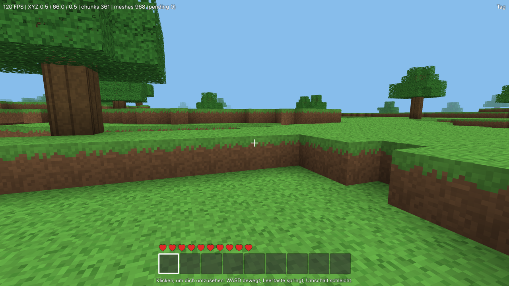

# QtCraft

A Minecraft-like voxel sandbox built with C++23 and Qt 6.8: procedurally generated worlds, mining and building, crafting, smelting in furnaces, hunger, farming with crops, pumpkins, melons and animal breeding, creatures, day and night, flowing water and lava, falling sand, plants, fireflies and mine lamps, synthesized sound and music, an in-game handbook generated from the content, saved worlds, data-only mods and a JSON control interface for agents and tests. Everything runs through a local server and a versioned binary protocol, so a network transport can be added later without touching the game logic.



## Build

Requirements: CMake 3.25+, a C++23 compiler (Apple Clang 21 tested), Qt 6.8 with Quick, QuickControls2, Multimedia, ShaderTools, LinguistTools and Test. The presets look for Qt in `~/Qt/6.8.3/macos`; pass `-DCMAKE_PREFIX_PATH=<qt dir>` for another location.

```sh
cmake --preset release
cmake --build --preset release
```

Presets: `debug`, `release`, `asan` (Address + UndefinedBehavior sanitizers), `tsan` (Thread sanitizer), `profile` and `deploy` (used by the scripts below). Build directories are `build/<preset>`.

## Release: a standalone app

```sh
scripts/release.sh
```

One command builds a universal (Apple silicon and Intel) Release build in `build/deploy` and puts a standalone `deploy/QtCraft.app` next to `deploy/QtCraft-<version>-macOS.zip` and `.dmg` (the `deploy/` folder is not in git). The app runs by double click on any Mac with macOS 13.3 or later, without Qt, build directory or command line. Inside are the Qt frameworks, QML modules and plugins (platform, image formats, styles, multimedia with the FFmpeg backend), the base content and translations (built into the program), the example mod, the icon, which the build draws from the game's own textures, and the dedicated server `QtCraft.app/Contents/MacOS/qtcraft-headless` (start it from Terminal, see [docs/Multiplayer.md](docs/Multiplayer.md)). Saves, settings and mods stay in `~/Library/Application Support/QtCraft/QtCraft`; on the first start the example mod is copied to its `mods` folder switched off – turn it on in the Mods screen.

Requirements: the build requirements above, Xcode command line tools (`codesign`, `otool`, `lipo`, `iconutil`, `hdiutil`) and `macdeployqt` from the Qt installation (`QT_DIR` overrides `~/Qt/6.8.3/macos`). The script checks its result and exits with 1 if any check fails: links and rpaths of every binary (`otool`), the required parts and Info.plist keys, the signature, that game and dedicated server are universal, a start of the copy's dedicated server (listens on a free loopback port, stops with exit code 0 on SIGTERM), and starts of a copy of the game in a temporary folder (a world with screenshot and the list of loaded libraries, which must all come from the copy or the system, the audio output, the example mod and the German texts, a start through Launch Services like a double click, and on Macs with Rosetta a start of the Intel half). Every start opens the (muted) audio output and keeps its caches in the temporary folder. `CFBundleVersion` is the UTC build time (`2026.1009.1130`). The starts open on the built-in display in the background and are muted. `QTCRAFT_RELEASE_DMG=0` skips the disk image, `QTCRAFT_RELEASE_PRESET` builds with another preset than `deploy` and `QTCRAFT_RELEASE_GUI=0` skips the starts of the game (machines without a display, such as the release workflow). It takes a few minutes and is not part of `scripts/verify.sh`.

The app is signed ad hoc only (`codesign -s -`); notarisation needs an Apple developer account. Another Mac therefore shows on the first start of a downloaded copy that “QtCraft” cannot be opened because Apple cannot check it for malicious software (macOS 15 and later: “QtCraft Not Opened”). To open it anyway: move the app to Applications, try to open it once, then in **System Settings → Privacy & Security** click **Open Anyway** next to the QtCraft message and confirm with your password; on macOS 13 and 14 right click (Control-click) the app in Finder, choose **Open** and confirm. macOS remembers the choice. Alternatively remove the download mark in Terminal: `xattr -dr com.apple.quarantine /Applications/QtCraft.app`. A copy without the download mark (for example built on that Mac) opens directly.

## Play

Double-click `deploy/QtCraft.app` after `scripts/release.sh`, or start a build directly:

```sh
build/release/src/app/qtcraft.app/Contents/MacOS/qtcraft
```

The main menu lists saved worlds, creates new ones (name, world type, optional seed, game mode survival or creative, whether the inventory is kept on death), and opens the settings, the character screen (outfit, hair, colours, presets, random look, with a live preview of the character that can be turned, zoomed and animated) and the mod list. The menu shows your character on a profile card, the inventory shows it next to the place of the armour slots.

| Input (default) | Action |
|-------|--------|
| Mouse, arrow keys | Look around (click into the window to capture the mouse) |
| W A S D, Space, Shift, Ctrl (Option on a Mac) | Move, jump, sneak, sprint (press once while walking forward, or tap W twice; lasts while W is held) |
| Left mouse / F | Mine; left click on a creature attacks it |
| Right mouse / R | Place the held block (stairs, slabs, torches, doors … turn and attach by where you look and click), eat held food when hungry, till grass or dirt with a hoe, plant seeds, carrots and potatoes on farmland, feed animals (pigs: carrots or potatoes, sheep: wheat) so they get young ones, open a crafting table, furnace or chest, open and close doors, trapdoors and gates (sneak to place against them); with an empty bucket take water or lava, with a full one pour it; with an empty glass bottle catch a firefly |
| Middle mouse / B | Pick block: put the item of the block in view into your hand (selects it in the hotbar or swaps it in; in creative mode taken from the catalogue) |
| Q, Ctrl+Q (Control+Q on a Mac) | Throw one item or the whole stack of the selected slot (walk over items to pick them up) |
| V or F5 | Switch the view: first person, third person behind, third person in front |
| 1–9, mouse wheel | Select a hotbar slot |
| E | Inventory with 2 × 2 crafting grid and recipe list; in creative mode the creative inventory (every block and item incl. mods, tabs, search, bin) |
| Space twice (creative) | Fly or stop flying; Space rises, Shift sinks, sprint doubles the speed, landing ends the flight |
| Ladders | Walk into the wall behind a ladder or jump to climb, sneak to hold on |
| Furnace screen | Something to smelt goes on top, fuel below, the result appears on the right; eat when the food bar right of the hearts runs low |
| Mine lamp | Clay (4, crafting table) → unfired lamp shell → furnace → fired shell + firefly in a bottle (fireflies glow over swamps at night) → lamp for floors, walls and ceilings |
| H or F1 | Handbook: every block, item, recipe, creature and biome with its values and links, plus chapters on playing (opens at the block in view; in the inventory, furnace and chests at the item under the mouse, or click the small ? on a slot) |
| T or Enter, / | Chat; `/` opens it with a command started (`/help`) |
| I or F3 | Debug display: off, compact (frame rate, frame time), full (position, light, target, time per subsystem with graphs) |
| O or F4 | Debug options: chunk borders, hitboxes, light values, creature goals, remesh flash |
| Esc | Pause menu (settings, save, quit to menu); closes the topmost screen first |

Every key except Esc can be changed under Settings → Controls (click a key, press the new one; Esc cancels, Backspace removes it, a key used by another action is swapped). The keys are stored in `settings.ini`; *Reset to defaults* restores the table above. **Mac keyboards:** F1–F12 control brightness, Mission Control, search and other system features, so macOS keeps them from the game; that is why every default key is a letter or another normal key, and the function keys are only second keys. To use them, hold fn or switch on “Use F1, F2, etc. keys as standard function keys” in System Settings → Keyboard → Keyboard Shortcuts → Function Keys. No default key uses Cmd or Control there, because macOS keeps Cmd+Q, Cmd+H, Cmd+Space, Cmd+Tab, Control+arrow keys and Control+Space for itself: sprint is Option, the whole stack is thrown with Control+Q, and Cmd cannot be bound at all. Putting an action on Control is allowed, but Control with the arrow keys or Space then switches desktops or the input source. Keys pressed together with Cmd do nothing in the game, so Cmd+Q quits (saving the world), Cmd+H hides and Cmd+W closes the window. Option+E, U, N and I are dead keys only while typing text; in the world they work as sprint plus that key.

Settings (view distance, field of view, mouse sensitivity, invert mouse, debug display and its visualisations, language, view mode, the character's look and saved character presets and the volumes of all sound, effects, music and ambience plus a mute switch) are stored in `settings.ini` in the data directory. The UI is available in English and German.

## Mods

Mods are data-only content packs in `<data directory>/mods` (macOS: `~/Library/Application Support/QtCraft/QtCraft/mods`). Try the example mod in this repository:

```sh
build/release/src/app/qtcraft.app/Contents/MacOS/qtcraft --mods-dir mods
```

See [docs/Modding.md](docs/Modding.md) for the format and the boundary between core and mods.

## Control interface and headless mode

`qtcraft-headless` plays the game without a window and takes JSON-line commands on stdin (or from `--script file.jsonl`):

```sh
printf '%s\n' '{"cmd":"waitUntilReady"}' '{"cmd":"move","forward":1,"ticks":40}' '{"cmd":"status"}' '{"cmd":"quit"}' \
  | build/release/src/headless/qtcraft-headless --seed 42
```

All commands are described in [docs/Steuerschnittstelle.md](docs/Steuerschnittstelle.md). `qtcraft-headless --console` runs a server console instead: every line of stdin is a server command (`help`, `op`, `whitelist`, `backup`, `tick`, `stop`, …; see the handbook chapter Commands). `qtcraft-headless --export-sounds DIR` writes every sound of the content (and one music piece) as WAV files. `qtcraft-headless --export-handbook DIR [--language de]` writes the base game's handbook as Markdown (add `--mods-dir DIR` to include mods); the base game's handbook is in [docs/handbook/](docs/handbook/index.md) (German: [docs/handbook/de/](docs/handbook/de/index.md)) and a test keeps it in sync with the content.

## Tests and checks

```sh
ctest --preset debug
scripts/verify.sh --quick [--tests <regex>] [--sanitizers asan|tsan]   # while working, a few minutes
scripts/verify.sh [--full] [--sanitizers asan|tsan]                    # once before a merge
```

`scripts/verify.sh --full` (the default) builds debug, ASan/UBSan, TSan and release, runs all tests in each sanitizer build, checks the size limits (functions and file lengths, E-088) and runs clang-tidy, clazy and qmllint over the whole project, and takes smoke screenshots. `--quick` builds and tests only debug (`--tests` limits the tests to a CTest regular expression) and analyses only the C++, Objective-C++ and QML files changed against `dev` (committed on the branch or not; a changed header is analysed through its `.cpp` of the same name, a header without one only gets the length check). `--sanitizers asan|tsan` limits `--full` to one sanitizer configuration, or adds it to `--quick` when threading code changed. Every step prints its duration, and a table of all durations ends the run. `scripts/static-analysis.sh [build-dir] [file ...]` runs the analysis alone. Set `QTCRAFT_DATA_DIR` to keep runs away from your real worlds; the tests always use `build/<preset>/test-data`.

## Performance and profiling

```sh
scripts/bench.sh [runs] [seconds]        # median per scenario, release build, view distance 8 (VIEW=12 for others)
scripts/bench-ab.sh <file> <rounds> <seconds> <label>=<app>[:TEXTURE_PACKS=<ids>]...  # interleaved A/B of several builds (or settings per label), order rotated per round, holds the bench lock
scripts/perf-check.sh                    # fixed generous limits for stand, sprint and crowd; exit code 1 on a regression
scripts/profile.sh <tool> [scenario] [seconds] [view distance]
```

`profile.sh` builds the `profile` preset (`build/profile`, RelWithDebInfo with QML debugging) and runs one short benchmark under a tool: `breakdown` (frame cost per scenario without VSync: GUI and render thread CPU time, GPU time, uploads, entity meshing, meshing per section, memory, sections), `time` (Instruments Time Profiler plus a text report of the hottest functions per thread), `metal` (Metal System Trace), `alloc` (`heap` and `vmmap`), `leaks`, `sample`, `qml` (`qmlprofiler` plus a report of the slowest bindings), `sg` (scene graph timing log) and `visualize` (`QSG_VISUALIZE` screenshots). Scenarios: `stand`, `walk`, `sprint`, `crowd`, `light`, `liquids`, `inventory`, `furnace`, `handbook` (see `scripts/bench-common.sh`). Raw data goes to a temporary directory outside the repository. All scripted runs open the window on the built-in display and in the background (`QTCRAFT_SCREEN=builtin`, `QTCRAFT_BACKGROUND=1`): they never take the focus or capture the mouse; set `QTCRAFT_SCREEN` to another screen index or name to override. None of these is part of `ctest`; never run them while building or testing. Results and goals: [docs/Performance.md](docs/Performance.md).

Useful hooks: `--play [--seed N] [--world NAME]`, `--world-type terrain|flat|void|showcase` (world types, also in the main menu; `--game-mode survival|creative` for the player of `--play`; `--flat-layers bedrock,59*stone,3*dirt,grass_block` for flat worlds), `--showcase` (the showcase world with every block, creature and item; screenshot tour `scripts/showcase-tour.sh`), `--look yaw,pitch`, `--spawn x,z`, `--chat TEXT` (`@<ms> TEXT` delays it), `--overlay inventory|creative|pause|settings|debug|character|chat|furnace|chest|handbook` (steps `@<ms> fly`, `@<ms> text:<objectName>=<text>`), `--debug-display off|compact|full`, `--debug-show chunkBorders,hitboxes,…`, `--stats <ms>` / `QTCRAFT_STATS=<ms>` (debug data as JSON lines `STATS {…}` in the log), `--handbook ENTRY|SEARCH`, `--camera first|behind|front|side`, `--pose walk|swing|swim|jump|sneak|death|fly|flysprint`, `--preview animation=walk,side=back,zoom=0.5,gaze=0.8:0.3,time=0` (fixes what the character previews show), `QTCRAFT_PREVIEW_ACTIVE=1` (character previews animate in the inactive window of a scripted run, for benchmarks), `--view-distance N`, `--screen builtin|INDEX|NAME`, `--background`, `--language de`, `--mods-dir DIR`, `--no-mods`, `--no-audio`, `QTCRAFT_AUDIO=0|1`, `QTCRAFT_SCREENSHOT=file.png` (silent unless `QTCRAFT_AUDIO=1`), `QTCRAFT_OFFSCREEN=1` (render without a shown window, independent of the display; scripts do this for screenshots unless `QTCRAFT_SHOT_MODE=window`), `QTCRAFT_BENCHMARK=seconds` (`QTCRAFT_BENCHMARK_SCENARIO=sprint|walk|stand|light|liquids`). The full list is in [docs/Architektur.md](docs/Architektur.md).

## Documentation

- [docs/handbook/index.md](docs/handbook/index.md) – the game's handbook (generated)
- [web/handbook/index.html](web/handbook/index.html) – the same handbook as a web page in the look of the game (generated data, published by the Pages workflow; open it through a local web server, e.g. `python3 -m http.server -d web`)
- [docs/Architektur.md](docs/Architektur.md) – modules, threads, protocol, content, persistence, gameplay rules, options
- [docs/Steuerschnittstelle.md](docs/Steuerschnittstelle.md) – control interface
- [docs/Modding.md](docs/Modding.md), [docs/Mod-Sicherheit.md](docs/Mod-Sicherheit.md) – mods and their security (German)
- [docs/Performance.md](docs/Performance.md), [docs/Performance-Verlauf.md](docs/Performance-Verlauf.md) – frame cost, hotspots, memory, goals and the per-stage measurements (German)
- [docs/Entscheidungen.md](docs/Entscheidungen.md), [docs/FORTSCHRITT.md](docs/FORTSCHRITT.md), [docs/Abschlussbericht.md](docs/Abschlussbericht.md) – decisions, progress and final report (German)
- [docs/ASSETS.md](docs/ASSETS.md) – textures and sounds (all procedural)

## Continuous integration

GitHub Actions (`.github/workflows/`), all against open-source Qt 6.8.3 installed by `install-qt-action` (presets `ci-debug` and `ci-deploy`, Qt from `QT_ROOT_DIR`):

- **CI** – every push to `dev` or `main` and every pull request: Debug build and all tests on macOS. Linux and Windows are built and tested too but are not ported yet; their failures do not fail the run.
- **Pages** – `web/` (the web handbook) from `main`.
- **Release** – a tag `v<version>` matching `project(QtCraft VERSION …)`: the tests, then `scripts/release.sh` without the starts of the game (try the package once before publishing), the `.zip` and `.dmg` go to a draft release that a maintainer publishes.

## Licence

QtCraft – code, textures, sounds and music – is licensed under the GNU General Public License version 3 or later (GPL-3.0-or-later), see [LICENSE](LICENSE) and [CREDITS.md](CREDITS.md). The release packages contain Qt, used under the GNU LGPL version 3.
