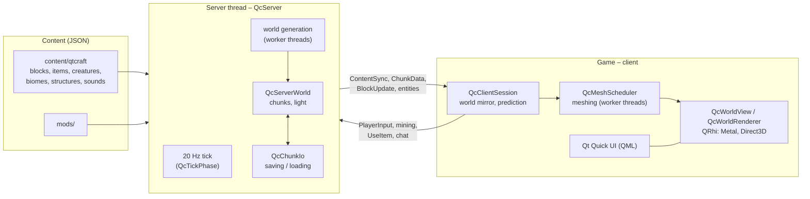

# How QtCraft works

A rough tour of the inside of QtCraft for curious readers: what happens between pressing a key and seeing a block disappear. It names the classes to look at, so you can jump into the code from here. For the full details – every message, file format and decision – see [Architektur.md](Architektur.md); the decisions (`E-<number>`) are in [Entscheidungen.md](Entscheidungen.md) (German). Proper API documentation is planned.

Class names start with `Qc`. To find one, search `docs/Code-Karte.md` (not checked in; generate it with `python3 scripts/code-map.py`), which lists every class with its file and first comment line.

## The big picture: a server, even when you play alone

QtCraft is split into a **server** that owns the world and decides everything, and a **client** that shows it and sends what the player wants to do. This holds even in single player: the game starts a server on a thread of its own inside the same process (`QcLocalServerHost`) and talks to it through an in-process link (`QcInProcessTransport`). In multiplayer the same messages travel over TCP instead.

Why bother in single player? Because there is then only one way the game works. Single player, LAN games and dedicated servers all run the same server code, and the client never has a shortcut into the server's data – the layers are checked by a script (`scripts/fix-includes.py --check`): the client libraries (`src/clientcore`, `src/app`) never include a server header.

## Talking: the protocol

Client and server exchange **frames**: a 16-bit message type followed by the payload written with `QDataStream` (`QcProtocol`). The protocol has a version number; a client and a server with different versions refuse each other cleanly. Typical messages: `Hello` and the login, `ContentSync` (the server sends its whole content catalogue to the client), `ChunkData` (one column of the world), `BlockUpdate`, `PlayerInput` (movement and view direction every tick), `StartMining`/`FinishMining`, `UseItem`.

Over the network every frame gets a length prefix (`QcTcpTransport`). Connections are encrypted with TLS through Qt's OpenSSL backend; the server uses a self-signed certificate, and the client remembers its fingerprint on the first connection, like SSH's `known_hosts` (`QcKnownServers`, `QcNetworkClient`, `QcTcpConnector`). The server accepts connections in `QcNetworkServer`. See [Multiplayer.md](Multiplayer.md).

## The heartbeat: the server tick

The server runs **20 ticks per second** (`QcServer`). Each tick runs fixed phases in a fixed order (`QcTickPhase`): players joining and leaving, saving, chunk loading, block updates, Signal Dust circuits (`QcServerCircuits`), liquids (`QcLiquidFlow`), fire, weather, creatures (`QcMobManager`), projectiles, items, plants, falling blocks, explosions, minecarts, machines, streaming chunks to the players, and finally sending entities and player state to the clients. Messages from the clients are handled between ticks.

The phases are also what the benchmarks and the debug display measure, so a slow tick says *which* part was slow. The tick can be sped up or stepped by hand (`/tick rate`, `/tick sprint`), which the tests use to simulate minutes in seconds.

Creatures think with small "brains" chosen by their data (`QcMobBrain`): wander, chase along paths, attack, flee, follow their owner. Villagers live in villages with beds, work and trades.

## The world: chunks, sections and block states

The world is cut into **chunks**: columns 16 × 16 blocks wide (`QcChunk`), split into **sections** of 16 × 16 × 16 blocks (`QcChunkSection`). A section stores a small palette of the block states that occur in it plus one index per block, packed into as few bits as the palette needs – a section that is all stone or all air costs almost nothing.

A block such as a staircase can face four ways, be upside down and so on. Every combination of its properties is a **block state** with a number of its own (`QcBlockStateTable`); those numbers are what chunks store and what travels over the network. On disk, block states are saved by name (`oak_stairs[facing=north,half=top]`), so a save stays valid when content is added.

**Light** comes in two channels, sky light and block light (torches, lava, lamps), with 16 levels each, spread block by block and updated incrementally when something changes (`QcLightEngine`). Server and client use the same engine.

## Making the world: generation

Generation is a pure function of the seed and the position: the same seed always gives the same world (`QcTerrainGenerator`). Roughly, for each chunk:

1. **Noise** (`QcNoise`, improved Perlin noise with fractal sums) shapes continents and oceans, rolling hills, ridged mountain ranges, terraces and cliffs.
2. A **climate map** (temperature, humidity, ruggedness, rarity), read at bent coordinates so borders fray naturally, picks the **biome** of each column from the biome definitions in `content/qtcraft/biomes`.
3. **Rivers** wind along the zero line of a noise field of their own down to the sea level (`QcRiverField`); wide rivers spread into deltas at the coast (`QcRiverDelta`).
4. **Caves** are carved as tunnels and caverns (`QcCaveCarver`), then ore veins, lava and water pools, trees, cacti and plants are placed – all described in JSON (`features/`, `ores/`).
5. **Structures** come last: dungeons, mineshafts, temples, coastal towers (`QcDungeonGenerator`, `QcMineshaftGenerator`, `QcSurfaceStructures` …) and **villages**. A village is planned per region from the seed and the terrain noise alone (`QcVillagePlanner`): a centre on flat land, roads with branches, houses from the biome's village style along the roads, bridges over rivers.

Chunks are generated on worker threads (`QcWorkerPool`) so the tick never waits; the server takes finished chunks over in its chunk-loading phase. Besides the normal world there are flat, void and showcase worlds (`QcWorldGenerators`, `QcShowcaseGenerator`).

## Saving

A world is a folder: `world.json` (name, seed, time, settings), one file per player, and binary **region files** holding the changed chunks of 32 × 32 chunk areas. Each chunk is one compressed blob with a checksum: a small palette of the block states it uses (by name, so content changes do not scramble a world), then the sections as packed indices into that palette, in the same encoding the network protocol uses (`QcChunkCodec`). Only `world.json` and the settings are text. Reading and writing happen on a thread of their own (`QcChunkIo`), so a save never stalls the game; `QcWorldStorage` handles the other files. Chunks that were never changed are not saved at all – they are generated again from the seed.

## Drawing a frame

The client keeps a mirror of the chunks the server sent (`QcWorldMirror`, inside `QcClientSession`). Turning those blocks into pictures happens in several steps:

- **Meshing.** Each 16³ section becomes a triangle mesh on a worker thread (`QcChunkMesher`, scheduled by `QcMeshScheduler`). Faces hidden behind a neighbouring opaque block are skipped (**face culling**), which removes the vast majority of faces. Every vertex gets face shading, ambient occlusion and its sky and block light. When a block changes, only the affected sections are meshed again.
- **Textures.** All block and item textures are drawn procedurally by the game (`QcProceduralTexture`, from JSON recipes in `textures/`) or come from a texture pack, and are packed into one big **texture atlas** with mip levels (`QcTextureAtlas`), so a whole section draws with one texture.
- **The GPU.** `QcWorldView` is a Qt Quick item that renders with **QRhi**, Qt's portable graphics layer: Metal on macOS, Direct3D on Windows. The shaders (`src/app/shaders/*.vert`, `*.frag`) are written once in GLSL and baked by Qt's shader tools for every backend at build time.
- **The frame** (`QcWorldRenderer`, `QcFramePlan`): first the sky as one screen-filling triangle with sun, moon, stars and clouds (`QcSkyRenderer`), then the opaque world, then entities, then translucent blocks such as water and glass, then rain and snow, then the overlay (the hand, the selection outline, debug lines). The section meshes live in GPU buffers managed by `QcGpuMeshStore`. Positions are sent to the GPU relative to the camera, so the picture stays exact even very far from the world's origin.
- **Creatures and players** are models made of boxes hung on bones (head, body, arms, legs), defined in `models/*.json`. A pose (`QcPose`) plus the walk, swing and other animations turn the bones (`QcAnimator`); `QcEntityMesher` builds the triangles every frame and `QcEntityFrameBuilder` collects everything that moves. Capes swing with a small spring simulation.

## Feeling instant: client prediction

The server is the boss, but waiting for its answer before moving would feel sluggish, even in single player. So the client **predicts**:

- **Movement.** The client runs the same physics as the server (shared code in `src/common`) on its own copy of the player and shows the result at once (`QcPrediction`). The server answers with the last input it processed and its authoritative position; the client takes the server's state and replays the inputs not yet acknowledged on top of it, so a disagreement is corrected at once. The client's own clock runs ticks on the same 50 ms grid as the server (`QcSessionCore`, `QcTickPacer`).
- **Blocks.** When you break or place a block, the client shows the result immediately on top of the server's world (`QcBlockMirror`), numbers the action, and drops its guess when the server confirms or corrects it.
- **Animation.** Arm swings and similar effects of the local player run locally (`QcLocalAnimation`).

## The user interface

Menus, inventory, HUD, settings and the handbook are **Qt Quick (QML)** screens (`src/app/qml`) drawn on top of the 3D view. They talk to C++ through controller objects, most of all `QcGameController`, which runs the session and exposes its state to QML as properties. Sounds and music are synthesized from JSON descriptions at start-up (`QcSoundSynthesizer`, `QcSoundBank`) – there are no audio files in the game.

## Content is data

Almost everything in the game is described in JSON in `content/qtcraft`: blocks and their shapes, items, recipes, creatures, biomes, ores, trees, structures, villages and their trades, sounds, textures, translations and the handbook chapters. At start-up the content pack loader reads it into one catalogue (`QcContentPackLoader`, `QcContentRegistry`). **Mods** are content packs of exactly the same kind, loaded after the base game in the order of their dependencies (`QcModLoader`); they cannot run code. When a player joins, the server sends its whole catalogue, so a client shows mod blocks it has never seen. See [Modding.md](Modding.md) and [Texturpakete.md](Texturpakete.md).

## The handbook writes itself

Because the content is data, the handbook can be generated from it (`QcHandbookBuilder`): every block, item, creature and biome gets a page with its values (break times, drops, recipes, light, spawn rules) computed by the same rules the game uses, plus hand-written chapters on playing. The same pages appear in the game, as Markdown in [handbook/](handbook/index.md) and as a web page (`web/handbook`); tests fail when the exported files differ from the content.

## Playing without a window: the control interface

`qtcraft-headless` runs a server and a client without any window. Its **control interface** (`QcControlInterface`) takes one JSON command per line – move, look, mine, use, read the status, run a command – and answers in JSON (`QcHeadlessGame`; `QcHeadlessJoin` lets such a bot join a real server). Tests and benchmarks use it to play the game by script, and it is the hook for AI agents to play. See [Steuerschnittstelle.md](Steuerschnittstelle.md). The same program is the dedicated server (`--server`).

## Keeping it working

- **Tests.** Several hundred QtTest programs (`tests/`) cover rules, generation, protocol, rendering offscreen and whole multiplayer sessions. World-generation tests use fixed seeds plus a random one per run.
- **Sanitizers.** `scripts/verify.sh` builds and tests the game with AddressSanitizer/UBSan and ThreadSanitizer as well, and runs clang-tidy, clazy and qmllint; threads hand data over as immutable snapshots through mutex-guarded mailboxes, which keeps TSan quiet.
- **Many runs at once.** Several agents often build and test in parallel on one machine; a small slot broker (`scripts/qc-slot.py`) hands out CPU budget so builds, tests and benchmarks do not trample each other.
- **Benchmarks** measure frame times, GPU time and tick phases in fixed scenarios, always interleaved old against new ([Performance.md](Performance.md), German).

More: [Building.md](Building.md) for building and testing, [Architektur.md](Architektur.md) for the full architecture.
